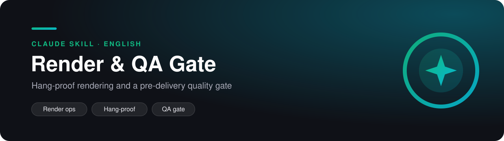

<p align="center"></p>

<p align="center">
  
  
  
</p>

<p align="center"><b>Hang-proof rendering and a pre-delivery quality gate</b></p>

---

## ✨ What it does

An operations card, packaged as a Claude skill, for rendering short-form videos on a shared, memory-constrained machine where agents and other jobs compete for resources. It covers one-render-at-a-time rules, hang prevention for ffmpeg and headless Chromium, and a pre-delivery quality gate.

- **Setup table:** work and temp folders, protected folders, RAM, busy windows, delivery targets.
- **Hang prevention:** bounded ffmpeg sources (`-t`, `eof_action=endall`, `-frames:v`), browser-close timeouts, a frame-counter heartbeat.
- **Quality gate:** Whisper transcript match, −14 LUFS, frozen frames, length, safe areas, centred subtitles, faces, logo colours.
- **One-line report:** `file | length | LUFS | gates: pass/fail (why)`.

## 💬 How to use

Once installed, just ask Claude in plain language:

> "Render episode 12 and run the QA gate."  
> "The render has been stuck at frame 840 for two minutes."  
> "Run the quality gate on final.mp4."  

## ⚙️ Install

**Claude Code**
```bash
git clone https://github.com/erencalik/video-render-qa-gate-claude.git ~/.claude/skills/video-render-qa-gate
```
**claude.ai:** download the repo as a ZIP (Code → Download ZIP) and upload it under Settings → Capabilities → Skills.

<details>
<summary>Files</summary>

| | |
|---|---|
| `SKILL.md` | the skill itself |
| `README.md` | this page |
| `assets/banner.svg` | banner |
| `LICENSE` | MIT |

</details>

## 🔗 Works well with

| Repo | What it does |
|---|---|
| [`quote-reels-editing-guide-claude`](https://github.com/erencalik/quote-reels-editing-guide-claude) | One-page editing spec for a daily quote Reels series |
| [`motion-graphics-video-generator-claude`](https://github.com/erencalik/motion-graphics-video-generator-claude) | One request to a scored MP4: HTML, headless Chromium, ffmpeg |

All skills and how they connect: [`claude-skills-collection`](https://github.com/erencalik/claude-skills-collection)

## 📄 Credits & license

Original skill, generalised from a production setup. MIT licensed, see [LICENSE](LICENSE).
